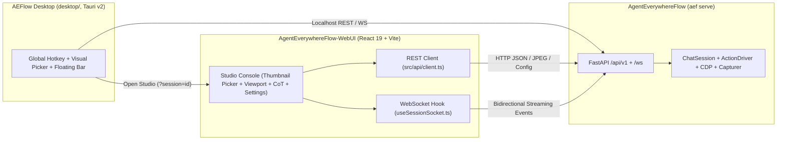

<div align="center">

# AgentEverywhereFlow WebUI

**Viewport-isolated studio console & desktop companion for embodied desktop agents, powered by [AgentEverywhereFlow](https://github.com/mcocdaa/AgentEverywhereFlow).**

[](https://github.com/mcocdaa)
[](https://github.com/mcocdaa/AgentEverywhereFlow-WebUI/actions)
[](package.json)
[](package.json)
[](LICENSE)

[English](README.md) · [简体中文](README_CN.md)

<br />


</div>

---

## ✨ Highlights

- 🖥️ **Zoom-Style Visual Target Picker** — Live thumbnail preview cards for screens and windows with multi-target pool checkboxes, custom screen crop **Region** presets, and **Headless Browser (CDP)** tab discovery (`--remote-debugging-port=9222`) for zero-interference background control.
- 🎯 **Isolated Viewport Monitor & Active Target Switcher** — Live pixel-accurate `(0, 0, width, height)` target frame stream with interactive `(X, Y)` cursor HUD, dynamic radar ripple markers, fullscreen inspection, and in-place target switching across bound pools or live desktop windows.
- ⚡ **Token-Streaming CoT & CodeAct Dialogue** — Bidirectional WebSocket stream rendering live `reasoning_delta` / `talk_delta` tokens smoothly alongside CodeAct Python blocks, tool-call telemetry, and `?session=<id>` URL deep-linking.
- ⚙️ **Zero-Terminal Model & API Key Settings** — Built-in provider presets (OpenAI, DeepSeek, OpenRouter, Ollama, Custom), write-only API key setup with masked preview, default execution/permission modes, and global hotkey display.
- 🛡️ **Human-in-the-Loop Guarded Mode & Workflow Export** — Toggle autonomous (`AUTO`) vs. supervised (`MANUAL`) approval gates on the fly; export trajectories to Python (`.py`), YAML (`.yaml`), Markdown (`.md`), or JSON with one-click Dry-Run replay.
- 🧩 **Companion Desktop Launcher (`desktop/`)** — Lightweight Tauri v2 companion app in [`desktop/`](desktop/) providing system tray, global summon hotkey (`Alt+Space`), hover/drag visual picker overlay, click-through target border, and one-click escalation (`?session=<id>`) into this Studio console.

---

## 🚀 Quick Start

### Option 1: Built into `AgentEverywhereFlow` (Recommended)

The production build of this Studio WebUI is bundled directly inside `AgentEverywhereFlow`:

```bash
# In the AgentEverywhereFlow repository or uv-installed environment
aef ui
# or start the headless daemon directly:
aef serve --host 127.0.0.1 --port 8000
```

Open **`http://127.0.0.1:8000`** in your browser to launch the studio console immediately and configure your VLM provider inside the **Settings** modal.

### Option 2: Standalone Frontend Development

Run the Vite development server against a running `aef serve` backend (`http://127.0.0.1:8000`):

```bash
git clone https://github.com/mcocdaa/AgentEverywhereFlow-WebUI.git
cd AgentEverywhereFlow-WebUI

npm install
npm run dev
```

Open **`http://localhost:5173`** in your browser. Vite proxies `/api` HTTP and WebSocket traffic to `http://127.0.0.1:8000` by default (see `vite.config.ts`). To connect to a different host or port at runtime, click the **Online / Offline** status pill in the Studio header to set a custom Backend Endpoint URL (saved in `localStorage['aef_api_base']`).

### Option 3: Lightweight Desktop Companion (`desktop/`)

See [`desktop/README.md`](desktop/README.md) for running or building the Tauri v2 desktop launcher (`AEFlow Desktop`) that pairs automatically with your local `aef serve` daemon.

---

## 🏗️ Architecture & Scripts



| Command | Description |
| :--- | :--- |
| `npm run dev` | Start Vite development server with HMR at `http://localhost:5173` |
| `npm run build` | Run TypeScript project references check (`tsc -b`) and bundle production assets into `dist/` |
| `npm run lint` | Run fast static analysis with `oxlint` |
| `npm run preview` | Preview the production bundle locally |

---

## 📄 License

Released under the [MIT License](LICENSE). Part of the `*Flow` ecosystem.
