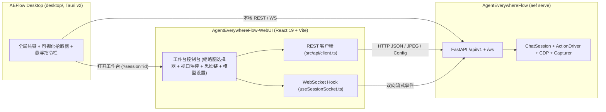

<div align="center">

# AgentEverywhereFlow WebUI

**基于 [AgentEverywhereFlow](https://github.com/mcocdaa/AgentEverywhereFlow) 的具身桌面智能体视口隔离控制台与轻量桌面伴侣。**

[](https://github.com/mcocdaa)
[](https://github.com/mcocdaa/AgentEverywhereFlow-WebUI/actions)
[](package.json)
[](package.json)
[](LICENSE)

[English](README.md) · [简体中文](README_CN.md)

<br />


</div>

---

## ✨ 核心特性

- 🖥️ **Zoom 风格可视化目标选择器** — 支持屏幕与窗口实时缩略图网格预览、多目标池勾选（Multi-Target）、自定义屏幕裁剪区域（**Region**）快捷预设，以及**无头浏览器（CDP）**标签页扫描（`--remote-debugging-port=9222`），实现零焦点干扰的后台点击与输入。
- 🎯 **隔离视口实时监控与活跃目标切换** — 严格对齐 `(0, 0, width, height)` 局部坐标契约，内置 `(X, Y)` 鼠标坐标 HUD、动作落点动态雷达波纹、全屏检视，以及视口顶部一键切换会话目标池或活动窗口。
- ⚡ **Token 级流式思维链与动作流** — 基于双向 WebSocket 事件总线，平滑流式呈现 `reasoning_delta` / `talk_delta` 实时推理输出、CodeAct Python 代码载荷，并支持 `?session=<id>` URL 深度直达会话。
- ⚙️ **零终端模型与密钥配置** — 内置服务商快捷预设（OpenAI、DeepSeek、OpenRouter、Ollama、自定义）、仅写入不回显明文的 API 密钥管理、默认执行/审批模式及全局召唤快捷键展示。
- 🛡️ **人机协同安全审批门控与工作流导出** — 运行时一键切换全自动（`AUTO`）与人工审批（`MANUAL`）模式；支持导出可执行 Python（`.py`）、YAML（`.yaml`）、Markdown 审计报告（`.md`）与 JSON 轨迹，并支持 Dry-Run 预演回放。
- 🧩 **轻量级桌面端伴侣（`desktop/`）** — 位于 [`desktop/`](desktop/) 的 Tauri v2 桌面端，提供系统托盘、全局召唤快捷键（`Alt+Space`）、悬停/框选可视化拾取器、点击穿透目标发光边框，以及一键跳转本工作台（`?session=<id>`）。

---

## 🚀 快速开始

### 方式一：通过 `AgentEverywhereFlow` 内置服务启动（推荐）

本 WebUI 的生产构建产物已直接内置于 `AgentEverywhereFlow` 核心库中：

```bash
# 在 AgentEverywhereFlow 仓库或 uv 安装环境中直接运行
aef ui
# 或单独启动后端守护进程：
aef serve --host 127.0.0.1 --port 8000
```

在浏览器打开 **`http://127.0.0.1:8000`** 即可直接使用完整工作台，并可在右上角**设置**弹窗中直接配置视觉大模型与 API 密钥。

### 方式二：独立前端开发调试

在已启动 `aef serve` 后端服务（`http://127.0.0.1:8000`）的前提下启动本地 Vite 开发服务器：

```bash
git clone https://github.com/mcocdaa/AgentEverywhereFlow-WebUI.git
cd AgentEverywhereFlow-WebUI

npm install
npm run dev
```

在浏览器打开 **`http://localhost:5173`**。开发模式下 Vite 默认将 `/api` 的 HTTP 与 WebSocket 请求代理至 `http://127.0.0.1:8000`（见 `vite.config.ts`）。如需运行时切换自定义后端地址或端口，请直接点击顶部状态胶囊打开**后端服务连接设置**（配置保存在浏览器 `localStorage['aef_api_base']` 中）。

### 方式三：轻量级桌面伴侣（`desktop/`）

请参阅 [`desktop/README.md`](desktop/README.md) 了解如何开发与构建 Tauri v2 桌面端（`AEFlow Desktop`），启动后可自动发现并挂载本地 `aef serve` 引擎。

---

## 🏗️ 架构与构建命令



| 命令 | 说明 |
| :--- | :--- |
| `npm run dev` | 启动 Vite 热更新开发服务器（`http://localhost:5173`） |
| `npm run build` | 执行 TypeScript 类型检查（`tsc -b`）并打包生产静态资源至 `dist/` |
| `npm run lint` | 使用 `oxlint` 执行静态代码检查 |
| `npm run preview` | 在本地预览生产环境构建产物 |

---

## 📄 开源协议

基于 [MIT License](LICENSE) 开源，隶属于 `*Flow` 生态家族。
